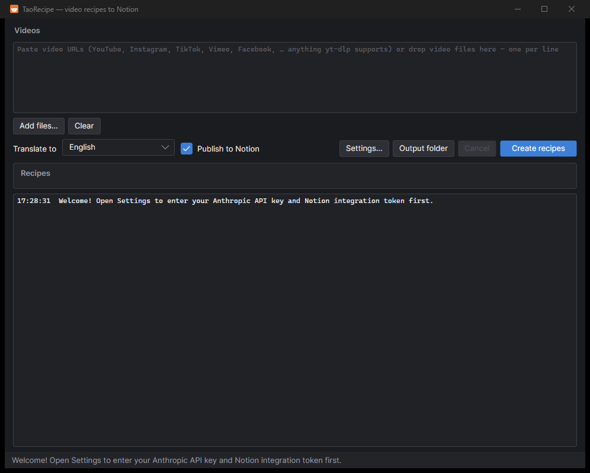

# TaoRecipe

Turns cooking videos into written, translated recipes with step screenshots, and imports them into Notion.

Input: any URL yt-dlp supports (YouTube, Instagram, TikTok, Facebook, Vimeo, Bilibili, …) or local video files.
Output: one Notion page per recipe in a **Recipes** database. Each page gets its own icon (a square crop of the finished dish), an
ingredient checklist, a numbered method with a screenshot under each step and a timestamp link back into the video, plus tips.
The local working copy (`recipe.json`, `recipe.md`, JPEGs in `Documents\TaoRecipe\<recipe>`) is deleted once the page is in Notion,
unless you tick *Keep local copy* (CLI `--keep-local`); with `--no-notion` it is always kept.



## Download

Get `TaoRecipe-<version>-win-x64.zip` from [Releases](../../releases), unzip it anywhere, and run `TaoRecipe.exe` (GUI) or
`taorecipe-cli.exe`. The build is self-contained, so no .NET install is needed. `yt-dlp` and `ffmpeg` must be on PATH, or you can set their paths in Settings.

## How it works

1. **Video**: yt-dlp downloads the video (≤1080p) and its metadata; descriptions often contain the exact quantities. Local files are used as they are.
2. **Transcript**: uploader subtitles when available, otherwise local **Whisper** (whisper.cpp via Whisper.net, large-v3-turbo by default,
   GPU via Vulkan with a normal graphics driver, or CUDA when the CUDA 13 runtime is installed; CPU fallback). The model downloads once to `%LOCALAPPDATA%\TaoRecipe\models`.
3. **Frames**: ffmpeg samples frames on scene changes (at least every 20 s, at most every 3 s; up to 90, 640 px).
4. **Claude** (Opus 5.5, structured JSON output) reads the metadata, transcript and frames together and writes the recipe(s) in the
   target language, choosing the best timestamp for each step. Several recipes in one video become separate pages. Two engines:
   - **Claude subscription** (default, no extra cost): runs your installed, signed-in [Claude Code](https://claude.com/claude-code)
     headless (`claude -p`, frames sent as images, `--json-schema` output). It uses your Pro/Max plan, not API credit.
   - **Anthropic API key**: billed per token; adaptive thinking and server-side refusal fallback (beta `server-side-fallback-2026-07-01`).
5. **Screenshots**: for each step, ffmpeg tests 5 frames around the chosen moment and keeps the sharpest (Laplacian variance) at up to 1600 px.
   Claude also picks the frame that best shows the finished dish and where the dish sits in it; a square crop of that becomes the 256 px page icon.
6. **Notion**: API version 2026-03-11. The tool creates the database on first use under your parent page, uploads the images through the
   File Upload API, and creates the page.

A failed run keeps its transcript and Claude result in `Documents\TaoRecipe\_work`, so a retry (e.g. after fixing Notion sharing) does
not transcribe or bill Claude again. Use `--fresh` to force a redo.

## Setup

Requirements: `yt-dlp` and `ffmpeg`/`ffprobe` on PATH (or set their paths in Settings).

1. **Claude**: either install [Claude Code](https://claude.com/claude-code) and sign in with your Claude account (TaoRecipe shows a
   **Sign in to Claude** prompt if needed), or switch the engine to an **Anthropic API key** from console.anthropic.com.
2. **Notion**: create an *internal integration* at <https://www.notion.so/profile/integrations> with Read, Update and Insert content
   capabilities. Copy its secret. In Notion, open the page that should hold the Recipes database, then ••• → **Connections** → add the integration.
   To use an existing recipes database instead, put its link in the **Database** field; TaoRecipe fills the columns whose names
   match (Name, Tags, Source, Cuisine, …) and writes everything else into the page body.
3. Enter the token and the page or database URL in the GUI's **Settings** (click *Test connections*), or with the CLI:

```
taorecipe-cli --set-notion-token ntn_...
taorecipe-cli --set-notion-parent https://www.notion.so/My-Kitchen-0123456789abcdef0123456789abcdef
taorecipe-cli --set-engine api                     # optional: use an API key instead of your subscription
taorecipe-cli --set-anthropic-key sk-ant-...
```

Secrets are stored DPAPI-encrypted in `%APPDATA%\TaoRecipe\settings.json`. `ANTHROPIC_API_KEY` / `NOTION_TOKEN` environment variables override them.

## Use

GUI (`TaoRecipe.exe`): paste URLs or drop files/folders (one per line; they run as a queue), choose the language, then click
**Create recipes**. If one video fails, the rest continue.

CLI:

```
taorecipe-cli "https://www.youtube.com/watch?v=..." D:\Videos\pasta.mp4
taorecipe-cli -l Dutch @urls.txt
taorecipe-cli --no-notion clip.mp4        # local copy only
```

Instagram, Facebook and similar sites may need cookies: set *yt-dlp extra arguments* to e.g. `--cookies-from-browser firefox`.

## Cost

With the **Claude subscription** engine there is no extra cost: a 30-minute video uses about 40–50k input and 7k output tokens of your
plan's usage (about a minute on Opus 5.5). Long queues can reach your plan's usage limit.
With an **API key**, the same video costs a few tens of cents on Opus 5.5. Pick Sonnet 5.5 or lower the frame count for cheaper runs.

## Build

```
dotnet build TaoRecipe.sln
```

Projects: `TaoRecipe.Core` (pipeline), `TaoRecipe.Cli` (`taorecipe-cli`), `TaoRecipe` (Avalonia GUI, dark theme).
